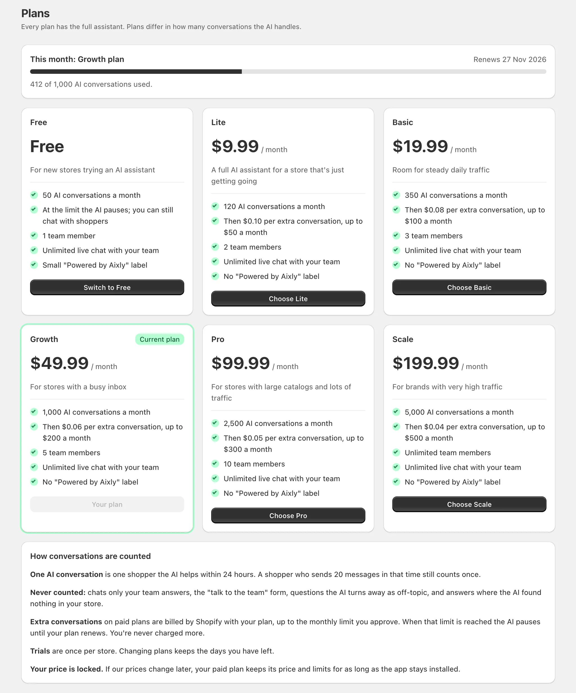

## Where to find it

- In the app, open **Plans**

---

## Available plans

Every plan has the full assistant: product answers, order tracking, add to cart, live chat, the team inbox and all languages. Plans differ in how many conversations the AI handles each month and how many team members you can invite. Live chat between your team and shoppers is unlimited on every plan.

| Plan | Price | AI conversations a month | Extra conversations | Monthly limit on extras | Team members |
|------|-------|--------------------------|---------------------|-------------------------|--------------|
| Free | $0 | 50 | none: the AI pauses | none | 1 |
| Lite | $9.99 | 120 | $0.10 each | $50 | 2 |
| Basic | $19.99 | 350 | $0.08 each | $100 | 3 |
| Growth | $49.99 | 1,000 | $0.06 each | $200 | 5 |
| Pro | $99.99 | 2,500 | $0.05 each | $300 | 10 |
| Scale | $199.99 | 5,000 | $0.04 each | $500 | Unlimited |

Paid plans include a **7-day free trial** and remove the small "Powered by Aixly" label from the chat.

Not sure which plan fits? The [plan calculator on aixly.io](https://aixly.io/pricing#calculator) works it out from your monthly AI conversations and team size, including what extra conversations would cost.

---

## How conversations are counted

An **AI conversation** is one shopper the AI helps within **24 hours**. A shopper who sends 20 messages in that time still counts once.

These are **never counted**:

- Chats that only your team answers (live chat)
- The chat's "talk to the team" form
- Questions the AI turns away as unrelated to your store
- Answers where the AI found nothing in your store

---

## When you reach your plan's conversations

- **Free plan:** the AI pauses until your plan renews. The chat stays on your store: shoppers get a form to reach your team, and live chat keeps working.
- **Paid plans:** the AI keeps answering, and each extra conversation is billed at your plan's rate. Shopify asks you to approve a monthly limit on these extras when you choose the plan. If that limit is reached, the AI pauses until your plan renews, so you're never charged more than you approved.

Extra charges appear in **Shopify Admin → Settings → Billing** and on the app's **Analytics** page.

---

## Free trials

The trial is once per store. If you change plans during the trial, you keep the days you have left. You can cancel any time from the **Plans** page (switch to Free) or by uninstalling the app.

---

## Upgrading or downgrading

Change your plan any time from the **Plans** page. Shopify asks you to confirm a paid plan on its own billing page. Switching to Free cancels the paid subscription right away.

If you have more team members than a smaller plan includes, everyone stays on the team, but you can't invite anyone new until you're under the limit.

---

## Your price is locked

If our prices change later, your plan keeps the price and limits you signed up with for as long as the app stays installed. If you uninstall and install again, you get the plans offered at that time.

---

## Usage and resets

Your **Plans** page shows how many AI conversations you've used this month and the date your plan renews. Counts reset on that date each month.
